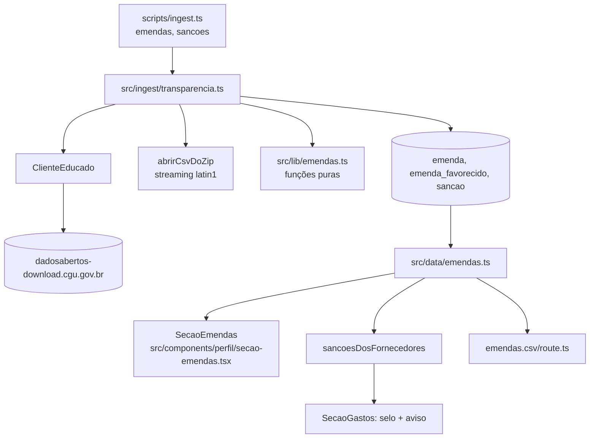

# Emendas parlamentares e sanções Design

**Spec**: `.specs/features/emendas-transparencia/spec.md`
**Status**: Approved (proposta visual aprovada em 2026-11-11)

---

## Architecture Overview

Mesmas três camadas do perfil: coletor grava no Postgres, camada de leitura agrega, página apresenta. Tudo novo fica em arquivos próprios para não colidir com as frentes de presença e Senado, que também mexem em `perfil.ts`, `metrics.ts` e `secoes.tsx`.

## Code Reuse Analysis

| Component | Location | How to Use |
| --------- | -------- | ---------- |
| `ClienteEducado.baixar` | `src/ingest/http.ts` | Download único de cada ZIP, com robots, 1 req/s e hash |
| `registrarColeta`, `inserirEmBlocos` | `src/ingest/coleta.ts` | Proveniência (R1) e inserção em blocos |
| `normalizarNome`, `dataBrParaIso` | `src/ingest/arquivos.ts` | Casamento autor ↔ deputado; datas do CEIS |
| `formatarCnpj`, `soDigitos` | `src/lib/privacy.ts` | Documento do favorecido e CNPJ sancionado |
| `Indicador`, `Fonte`, estilos | `src/components/perfil/*` | Mesmo visual dos blocos existentes |
| `gastos.csv/route.ts` | `src/app/parlamentares/[id]/gastos.csv` | Padrão do CSV de download |

## Components

### Esquema (migração `0007_emendas`)

- `emenda`: `id` serial, `codigo`, `ano`, `tipo`, `autor_nome`, `parlamentar_id` (FK), `localidade`, `uf`, `funcao`, `empenhado`, `liquidado`, `pago`, `rp_pagos` (numeric), `coleta_id`. Índice em `(parlamentar_id, ano)`.
- `emenda_favorecido`: `id` serial, `codigo_emenda`, `parlamentar_id`, `ano_emenda`, `ano_mes`, `favorecido_nome`, `favorecido_doc` (nulo, CNPJ formatado ou CPF já mascarado), `tipo_favorecido`, `uf`, `municipio`, `valor`, `coleta_id`. Índice em `(parlamentar_id, ano_emenda)`.
- `sancao`: `id` serial, `cadastro` ('CEIS' | 'CNEP'), `codigo`, `cnpj` (14 dígitos), `nome`, `categoria`, `data_inicio`, `data_fim` (nulo), `orgao`, `coleta_id`. Índice em `cnpj`.

Número 0007: 0005 e 0006 estão reservados para Senado e presença. O `Migrator` roda em ordem de nome; as outras migrações entram antes no merge, então quem aplicar 0007 antes delas precisa de `allowUnorderedMigrations` ou de um banco recriado. Para não quebrar `auditaja_test`, esta frente usa `auditaja_emendas_test` e `auditaja_emendas_dev`.

### Funções puras (`src/lib/emendas.ts`)

`valorBr("1.234,56") → "1234.56"`, `rotuloLocalidade`, `favorecidoPublicavel(tipo, codigo, nome)`, `indiceDeAutores(parlamentares) → Map<nomeNormalizado, id | null>` (null = homônimo), `ehTransferenciaEspecial(tipo)`, `periodoEmendas(param, anosDisponiveis)`.

### Coletor (`src/ingest/transparencia.ts`)

- `coletarEmendas(db, cli)`: baixa o ZIP, lê `EmendasParlamentares.csv` (47 MB, cabe em memória) e `EmendasParlamentares_PorFavorecido.csv` (183 MB) em streaming por `abrirCsvDoZip`, filtra, grava tudo numa transação (`delete` + insert).
- `coletarSancoes(db, cli, hoje)`: para CEIS e CNEP, tenta `AAAAMMDD_<BASE>.zip` de hoje até 7 dias atrás; filtra tipo J e CNPJ presente em `despesa_ceap`; substitui as sanções do cadastro.
- `abrirCsvDoZip` em `src/ingest/arquivos.ts`: `yauzl` + `iconv-lite` + `csv-parse` em stream, devolvendo um `AsyncIterable<Linha>`.

### Leitura (`src/data/emendas.ts`)

- `emendasDoParlamentar(id, periodo)`: totais, série por ano, top 5 áreas, top 5 locais, top 5 favorecidos, anos disponíveis, coleta.
- `sancoesDosFornecedores(id, cnpjs, periodoCeap)`: sanções por CNPJ e contagem de notas com `data_emissao` dentro do período da sanção.

### UI

- `SecaoEmendas` (arquivo novo) recebe o resultado da leitura; página insere a seção entre gastos e votações, dentro do `Suspense` existente.
- `AbasSecoes`: entrada `emendas` depois de `gastos`; a rolagem considera `emendas` na coluna principal.
- `SecaoGastos`: prop opcional `sancoes`; selo na linha do fornecedor e aviso abaixo da tabela.
- `Lateral`: duas fontes novas e o bloco "Como ligamos a emenda ao deputado".
- `/metodologia`: duas seções; `METODOLOGIA_VERSAO` = "1.4".

## Error Handling Strategy

| Error Scenario | Handling | User Impact |
| -------------- | -------- | ----------- |
| 401/403 no arquivo | `ColetaBloqueada`, transação não abre | Mantém os dados anteriores |
| ZIP sem a entrada esperada | erro "entrada não encontrada no zip" | Idem |
| Sem arquivo de sanção em 7 dias | erro e nenhuma escrita | Idem |
| Deputado sem emendas | frase de vazio (EMDUI-13) | Seção explica a ausência |

## Tech Decisions

| Decision | Choice | Rationale |
| -------- | ------ | --------- |
| Host de download | Servidor de arquivos da CGU | O host principal responde com captcha; ver AD-004 |
| Leitura do CSV grande | Streaming | 183 MB descompactados em latin1 estouram o heap com `csv-parse/sync` |
| Agregação | Na consulta (SQL) | 15–20 mil linhas por base; dispensa tabela de resumo |
| Parâmetro de período | `?emendas=` | Não colide com `?ano=` da cota |
