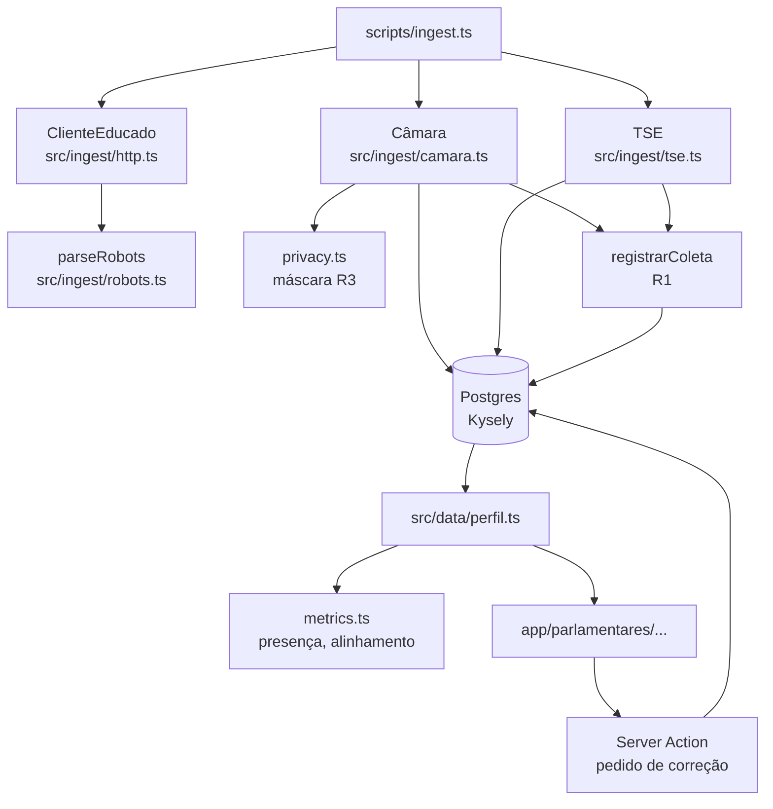

# Perfil do deputado federal Design

**Spec**: `.specs/features/perfil-parlamentar/spec.md`
**Status**: Approved (retroativo: descreve o que foi implementado no PR #1)

---

## Architecture Overview

Três camadas com fronteiras claras: coletores escrevem no Postgres; uma camada de leitura agrega; as páginas do Next.js só apresentam. Regras de privacidade e de métrica são funções puras, testadas sem banco.

---

## Code Reuse Analysis

### Existing Components to Leverage

Projeto novo (commit inicial só com README). Reuso vem do ecossistema:

| Component | Location | How to Use |
| --------- | -------- | ---------- |
| shadcn/ui (base-nova) | `src/components/ui/*` | Tokens de cor e componentes base; o perfil usa HTML semântico com as mesmas classes |
| Kysely Migrator | `kysely/migration` | Migrações explícitas em `src/db/migrate.ts` |
| csv-parse, yauzl, iconv-lite | `src/ingest/arquivos.ts` | Leitura de CSV `;` em UTF-8 (Câmara) e Latin-1 (TSE) dentro de ZIP |
| Protótipo aprovado | artifact `bd51453d…` | Ordem das seções, indicadores e textos de fonte |

### Integration Points

| System | Integration Method |
| ------ | ------------------ |
| Câmara, API v2 | `GET /deputados` paginado (HATEOAS `links.next`) |
| Câmara, arquivos em lote | `deputados.csv`, `orgaosDeputados-L57.csv`, `votacoes*-AAAA.csv`, `cotas/Ano-AAAA.csv.zip` |
| TSE, CDN | `consulta_cand_AAAA.zip` e `bem_candidato_AAAA.zip` (arquivo `_BRASIL.csv`, fallback por UF) |
| Postgres 16 | docker compose, porta 5436; bancos `auditaja` e `auditaja_test`; extensão `unaccent` |

---

## Components

### ClienteEducado

- **Purpose**: Único caminho de rede dos coletores; aplica R7.
- **Location**: `src/ingest/http.ts`
- **Interfaces**:
  - `get(url, accept?): Promise<Response>`: robots, intervalo, backoff, bloqueio em 401/403.
  - `json<T>(url): Promise<T>`
  - `baixar(url, dirCache): Promise<{ arquivo, sha256, bytes, buf }>`
- **Dependencies**: `parseRobots`; `fetch` e `dormir` injetáveis para teste.
- **Reuses**: nada.

### parseRobots

- **Purpose**: Interpretar robots.txt (RFC 9309) para o nosso User-Agent.
- **Location**: `src/ingest/robots.ts`
- **Interfaces**: `parseRobots(texto, userAgent): { permite(path), crawlDelaySegundos }`; constantes `PERMITE_TUDO`, `BLOQUEIA_TUDO`.

### Transformações Câmara / TSE

- **Purpose**: Converter linhas das fontes em linhas do banco, aplicando R2/R3.
- **Location**: `src/ingest/camara.ts`, `src/ingest/tse.ts`
- **Interfaces**: `montarParlamentares`, `linhaCeap`, `montarVotacoes`, `montarOrgaos`, `casarCandidaturas`, `montarBens` (puras); `coletar*` (rede + banco, substituição por ano em transação).
- **Reuses**: `documentoPublicavel`, `nomeFornecedorPublicavel`, `registrarColeta`, `inserirEmBlocos`.

### Regras puras

- **Purpose**: Privacidade, formatação e métricas sem dependência de banco.
- **Location**: `src/lib/privacy.ts`, `src/lib/format.ts`, `src/lib/metrics.ts`
- **Interfaces**: `mascararCpf`, `documentoPublicavel`, `tipoBancadaParaPartido`, `orientacaoDoPartido`, `alinhamento`, `variacaoNominal`, `tetoAcumulado`, `numeroBr`, `dataBr`.

### Camada de leitura

- **Purpose**: Agregar o perfil e a busca para as páginas.
- **Location**: `src/data/perfil.ts` (`server-only`)
- **Interfaces**: `buscarParlamentares({ q, uf, todos, limite })`, `ufsDisponiveis()`, `perfilParlamentar(id, ano?)`.

### Páginas

- **Location**: `src/app/{page,parlamentares,parlamentares/[id],parlamentares/[id]/contestar,metodologia,fontes}`
- **Notes**: Cache Components ligado; páginas com banco chamam `connection()` e ficam sob `app/loading.tsx` (streaming). Filtros e ano via `searchParams`, sem JS de cliente; só o formulário de correção é Client Component (`useActionState`).

---

## Data Models

Definidos em `src/db/types.ts` e `src/db/migrations/0001_init.ts`:

| Tabela | Chave | Observação |
| ------ | ----- | ---------- |
| `coleta` | `id` | R1: fonte, url, coletado_em, sha256, bytes, licenca |
| `parlamentar` | `id` (id da Câmara) | `data_nascimento` só para casar com o TSE, não exibida |
| `orgao_membro` | — | cargos em órgãos; `data_fim` nula = atual |
| `despesa_ceap` | `id` | `fornecedor_doc` já mascarado; `fornecedor_classe` (R3) |
| `votacao` / `voto` / `orientacao` | `id` / (votacao, parlamentar) / (votacao, bancada) | só votações com voto nominal |
| `candidatura` / `bem_declarado` | (ano, sq_candidato) / `id` | bem guarda só tipo e valor |
| `pedido_correcao` | `id` | status com `check` |

Todo registro de dado coletado tem `coleta_id` com FK para `coleta`.

---

## Error Handling Strategy

| Error Scenario | Handling | User Impact |
| -------------- | -------- | ----------- |
| robots.txt proíbe caminho | `ColetaBloqueada`; CLI sai com código 1 | Operador vê a mensagem; nada é gravado |
| 429/5xx | até 4 tentativas com backoff | Coleta mais lenta |
| 401/403 | `ColetaBloqueada`, sem retry | Operador decide (LAI, contato) |
| Falha no meio da carga | transação por ano: rollback | Dados do ano anterior continuam |
| Perfil inexistente | `notFound()` | "Página não encontrada" (status 200, `noindex`) |
| Pedido de correção inválido | Zod no Server Action | Mensagem em `role="alert"` |

---

## Risks & Concerns

| Concern | Location (file:line) | Impact | Mitigation |
| ------- | -------------------- | ------ | ---------- |
| Orientação de bloco truncada pela Câmara | `src/lib/metrics.ts:55` | Partidos fora da abreviação ficam sem alinhamento | Documentado na metodologia; follow-up: mapear blocos pela API `/orgaos` |
| Lista fixa de siglas completas | `src/lib/metrics.ts:31` | Partido novo pode virar prefixo de outro | Revisar a lista a cada legislatura; teste cobre PSD × PSDB |
| Teto da CEAP só para 2026 | `src/data/teto-ceap.ts:58` | Outros anos sem % do teto; jan–fev/2026 usam o valor novo (teto um pouco acima do real) | Valores da página oficial da Câmara, conferidos em 11/11/2026; aproximação descrita na metodologia |
| Perfil inexistente responde 200 | `src/app/loading.tsx:1` | Crawlers podem indexar | `noindex` emitido pelo Next; avaliar `instant = false` no perfil |
| Arquivos inteiros em memória | `src/ingest/http.ts:110` | CEAP anual ~47 MB descompactado | Aceitável no MVP; trocar por stream se crescer |
| Busca por `like` com `unaccent` sem índice funcional | `src/data/perfil.ts:40` | Lento com muitos registros | ~650 linhas hoje; criar índice se crescer |

---

## Tech Decisions (only non-obvious ones)

| Decision | Choice | Rationale |
| -------- | ------ | --------- |
| Fonte da CEAP | Arquivo anual em lote, não `/deputados/{id}/despesas` | 1 requisição em vez de milhares (R7) |
| Votações | Arquivos anuais de votos e orientações | Idem; inclui orientações que a API devolve por votação |
| Data como texto | `pg.types.setTypeParser(1082)` | Evita deslocamento de fuso em `date` |
| Renderização | Server Components + `searchParams` | Filtros funcionam sem JS; menos superfície de cliente |

Decisões de projeto (valem para outras features) estão em `.specs/STATE.md` (AD-001 a AD-003).
