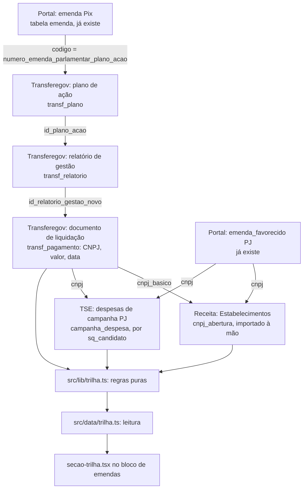

# Seguir o dinheiro das emendas Design

**Spec**: `.specs/features/seguir-dinheiro/spec.md`
**Status**: Approved (abordagem A escolhida pelo usuário em 2026-11-12)

---

## Architecture Overview

Três coletas novas gravam os elos brutos. Os indícios são calculados na leitura, como o padrão atípico (AD da feature `padrao-atipico`), então a ordem das coletas não muda o resultado e a mudança de limiar não exige recoleta.



### Abordagens consideradas

| Abordagem | Como | Prós | Contras |
| --------- | ---- | ---- | ------- |
| **A. Elos brutos + indício na leitura (recomendada)** | Tabelas por elo; `src/lib/trilha.ts` calcula os dois sinais a cada leitura do perfil | Mesmo padrão do atípico; limiar muda sem recoleta; reproduzível a partir dos `coleta_id` | Cálculo da taxa de base percorre a base inteira; precisa de índice e cache da página |
| B. Indícios gravados na ingestão (`indicio`) | Coleta calcula e grava regra, parâmetros e versão | Histórico por versão de metodologia; leitura barata | Acopla ordem das coletas; recalcular a cada limiar; mais uma tabela para manter coerente |
| C. Grafo (DuckDB/Parquet, como no vídeo) | Exportar elos e percorrer caminhos | Saltos ilimitados | Fora de escopo; outra stack; não cabe no perfil nominal |

---

## Code Reuse Analysis

### Existing Components to Leverage

| Component | Location | How to Use |
| --------- | -------- | ---------- |
| `ClienteEducado`, `ColetaBloqueada`, `sha256De` | `src/ingest/http.ts` | Paginar o Transferegov (1 req/s, robots, User-Agent) e parar em 4xx/429 (TRI-06) |
| `registrarColeta`, `inserirEmBlocos` | `src/ingest/coleta.ts` | Uma `coleta` por coleta/arquivo (R1, AD-003) |
| `linhasCsvDoZip`, `dataDaEntrada` | `src/ingest/arquivos.ts` | Ler os ZIPs da Receita e do TSE em fluxo, sem carregar o arquivo inteiro |
| `soDigitos`, `formatarCnpj`, `documentoPublicavel` | `src/lib/privacy.ts` | Validar CNPJ, descartar PF (TRI-03, TRI-07) |
| `ehTransferenciaEspecial`, `brlMi`, `baseDaColeta` | `src/lib/emendas.ts` | Filtrar emendas Pix e formatar valores |
| `emendasDoParlamentar` | `src/data/emendas.ts` | Ponto de entrada: a trilha usa as mesmas emendas e o mesmo período |
| `SecaoEmendas`, `CARTAO`, `H2`, `Fonte` | `src/components/perfil/` | A trilha entra como sub-bloco da seção de emendas, no mesmo estilo dos avisos de sanção (`sancao.tsx`) |
| `METODOLOGIA_VERSAO` | `src/lib/metrics.ts` | Sobe para a próxima livre (hoje 1.11) |
| Fixture e seed por feature | `tests/fixtures/atipico.ts`, `scripts/seed.ts` | Mesmo padrão: ids fora de exercício, banco `_test` próprio |
| `casarCandidaturas`, `urlCandidatos` | `src/ingest/tse.ts` | `candidatura.sq_candidato` já liga o candidato ao parlamentar |

### Integration Points

| System | Integration Method |
| ------ | ------------------ |
| Transferegov (`api-publica.transferegov.gestao.gov.br/especiais`) | GET paginado, `tamanho_da_pagina=200` (máximo aceito, 422 acima). Volumes medidos em 12/11/2026: planos 58.990 (295 req), relatórios 27.666 (139 req), documentos de liquidação 106.333 (532 req). ≈ 970 req ≈ 17 min a 1 req/s. `robots.txt` = 404 (permitido). |
| Receita (arquivo local) | `pnpm ingest receita --arquivo <zip>` repetido para `Estabelecimentos0..9.zip`; nunca rede (CNPJ-07) |
| TSE (`cdn.tse.jus.br`) | `prestacao_de_contas_eleitorais_candidatos_{ano}.zip` (2022: 521 MB, conferido); lê só o CSV de despesas, filtra `SQ_CANDIDATO` presente em `candidatura` |
| Banco | Migração nova (próxima livre: 0012) com 5 tabelas; registrar em `src/db/migrate.ts` (lista explícita) |

---

## Components

### Coletor Transferegov

- **Purpose**: Gravar planos, relatórios e documentos de liquidação das emendas Pix de parlamentares da base.
- **Location**: `src/ingest/transferegov.ts`
- **Interfaces**:
  - `coletarTransferegovPix(db, cli): Promise<ResumoPix>` - pagina os três recursos, liga por id, grava e devolve contagens (ligados, sem código, CNPJ inválido, PF agregados)
  - `paginas<T>(cli, recurso, params): AsyncGenerator<T[]>` - paginação genérica até `total_pages`
- **Dependencies**: `ClienteEducado`, tabela `emenda` (código), `parlamentar`
- **Reuses**: padrão de `coletarEmendas` (apagar e regravar por fonte em transação)

### Importador Receita

- **Purpose**: Ler um ZIP "Estabelecimentos" local e gravar data de início de atividade e CNAE dos CNPJs que já estão no banco.
- **Location**: `src/ingest/receita.ts`
- **Interfaces**:
  - `importarEstabelecimentos(db, caminho): Promise<ResumoReceita>` - lê em fluxo, filtra pelo conjunto de CNPJs básicos conhecidos, grava matriz e filiais conhecidas
  - `mesDoLote(caminho | entrada): string` - "AAAA-MM" para EDGE-06
- **Dependencies**: `transf_pagamento`, `emenda_favorecido`, `despesa_ceap` (conjunto de CNPJs)
- **Reuses**: `linhasCsvDoZip`, `registrarColeta` (URL = `file://` + nome do arquivo, SHA-256 do ZIP)

### Coletor TSE contas

- **Purpose**: Gravar despesas de campanha com fornecedor PJ dos candidatos casados.
- **Location**: `src/ingest/tse.ts` (nova função)
- **Interfaces**:
  - `coletarDespesasCampanha(db, cli, ano): Promise<ResumoCampanha>`
- **Dependencies**: `candidatura`
- **Reuses**: `ClienteEducado`, `linhasCsvDoZip`, padrão de `coletarBens`

### Regras da trilha

- **Purpose**: Funções puras dos dois sinais e da taxa de base.
- **Location**: `src/lib/trilha.ts`
- **Interfaces**:
  - `recemAberta(abertura: Date, primeiroPagamento: Date): { dias: number; indicio: boolean }` - `indicio` se `dias < 180` (CNPJ-03, CNPJ-04)
  - `cicloFechado(cnpjsDaEmenda: Set<string>, despesasCampanha: {cnpj; data}[], dataPagamento: Date): Ciclo[]` - só despesas com data ≤ pagamento (LING-06)
  - `taxaDeBase(m: number, n: number): string` - "M de N (x,x%)" (LING-07)
  - `DIAS_RECEM_ABERTA = 180`
- **Dependencies**: nenhuma
- **Reuses**: estilo de `src/lib/atipico.ts`

### Leitura da trilha

- **Purpose**: Montar, por parlamentar, a trilha das emendas Pix, os indícios e a taxa de base.
- **Location**: `src/data/trilha.ts`
- **Interfaces**:
  - `trilhaDoParlamentar(id, periodo): Promise<Trilha>`
  - `taxasDeBase(): Promise<{ recemAberta: [m, n]; ciclo: [m, n] }>` - uma consulta agregada, cache da página
- **Dependencies**: tabelas novas, `emenda`, `candidatura`
- **Reuses**: período de `emendasDoParlamentar`

### Seção "Para onde foi o dinheiro"

- **Purpose**: Desenhar o bloco aprovado (desktop e celular).
- **Location**: `src/components/perfil/secao-trilha.tsx`, chamada de `secao-emendas.tsx`
- **Reuses**: `CARTAO`, `Fonte`, cartão de aviso de `sancao.tsx`, link "Contestar" existente

### CSV e metodologia

- **Location**: rota de CSV do perfil (colunas `indicio`, `versao_metodologia`), `src/app/metodologia` (seção por sinal com regra, limiar, exemplo, causas de falso positivo)

---

## Data Models

```typescript
// transf_plano: um plano de ação de emenda Pix
interface TransfPlano {
  id_plano_acao: number          // PK, id do Transferegov
  codigo_emenda: string          // numero_emenda_parlamentar_plano_acao = emenda.codigo
  parlamentar_id: number | null  // via emenda.codigo; null = não ligado (EDGE-01)
  beneficiario_cnpj: string | null
  valor: string                  // custeio + investimento
  data_aceite: string | null
  coleta_id: number
  // nunca: banco, agência, conta (TRI-03)
}

// transf_pagamento: documento de liquidação de um relatório de gestão
interface TransfPagamento {
  id: number                     // id_relatorio_gestao_dl
  id_plano_acao: number          // via relatorio_gestao_novo
  recebedor_cnpj: string | null  // só CNPJ válido; PF → null + tipo 'pf'
  recebedor_nome: string | null  // só PJ
  tipo: 'pj' | 'pf'
  valor: string
  data_pagamento: string
  coleta_id: number
}

// cnpj_abertura: do lote Estabelecimentos (só CNPJs conhecidos)
interface CnpjAbertura {
  cnpj: string                   // 14 dígitos, PK
  cnpj_basico: string            // 8 dígitos
  matriz: boolean                // IDENTIFICADOR MATRIZ/FILIAL = 1
  inicio_atividade: string
  cnae_principal: string
  base_mes: string               // AAAA-MM
  coleta_id: number
}

// campanha_despesa: despesa de campanha com fornecedor PJ
interface CampanhaDespesa {
  id: number
  ano_eleicao: number
  sq_candidato: string           // liga a candidatura.sq_candidato
  parlamentar_id: number
  fornecedor_cnpj: string
  valor: string
  data_despesa: string
  coleta_id: number
}
```

**Relationships**: `transf_plano.codigo_emenda` → `emenda.codigo`; `transf_pagamento.id_plano_acao` → `transf_plano`; `cnpj_abertura.cnpj_basico` ↔ CNPJ de `transf_pagamento`/`emenda_favorecido`; `campanha_despesa.sq_candidato` → `candidatura`. Índices em `transf_pagamento(recebedor_cnpj)`, `campanha_despesa(fornecedor_cnpj)`, `cnpj_abertura(cnpj_basico) where matriz`.

---

## Error Handling Strategy

| Error Scenario | Handling | User Impact |
| -------------- | -------- | ----------- |
| Transferegov 4xx/429/5xx no meio da paginação | `ColetaBloqueada`; transação não comita; dados anteriores ficam | Perfil mostra a coleta anterior com a data dela |
| Plano sem código de emenda ou código não encontrado | Não liga; conta no resumo (EDGE-01) | Nenhum |
| CNPJ com dígito inválido | Descarta o elo; conta no resumo (EDGE-02) | Nenhum |
| ZIP da Receita de mês anterior ao vigente | Recusa com os dois meses (EDGE-06) | Nenhum |
| Matriz fora do lote | Usa a filial e avisa (EDGE-05) | Texto "data da filial; matriz não encontrada" |
| CNPJ sem abertura na base | Sem indício, texto CNPJ-05 | "Data de abertura não encontrada…" |
| Parlamentar sem emenda Pix | Esconde a trilha (EDGE-04) | Frase de vazio |

---

## Risks & Concerns

| Concern | Location (file:line) | Impact | Mitigation |
| ------- | -------------------- | ------ | ---------- |
| Layout do CSV de despesas do TSE não conferido (nomes de colunas `NR_CPF_CNPJ_FORNECEDOR`, `DT_DESPESA`, `SQ_CANDIDATO` são suposição) | `src/ingest/tse.ts` (novo) | Coleta quebra ou grava coluna errada | Primeira tarefa da fase TSE baixa o ZIP uma vez e confere o cabeçalho antes de escrever o parser; fixture a partir do cabeçalho real |
| Transferegov pagina por offset numa base que muda todo dia (`data-atualizacao` diário) | `src/ingest/transferegov.ts` (novo) | Linha pulada ou duplicada entre páginas | Deduplicar por id; registrar `data-atualizacao` em `coleta.observacao`; conferir `total_items` no fim |
| Relatório de gestão pode cobrir pagamentos de mais de uma emenda do mesmo plano | idem | Valor atribuído à emenda errada | O plano de ação é de uma emenda (`numero_emenda_parlamentar_plano_acao`); conferir na amostra de 10 emendas (critério de sucesso) |
| Lote Estabelecimentos tem ~60 milhões de linhas em 10 ZIPs | `src/ingest/receita.ts` (novo) | Memória e tempo | Fluxo linha a linha; filtrar por `Set` de CNPJ básico em memória (~45 mil) |
| Taxa de base percorre todas as emendas Pix a cada perfil | `src/data/trilha.ts` (novo) | Página lenta | Uma consulta agregada com cache (`cacheComponents` já ligado) |
| `perfil.ts`, `secoes.tsx`, `metrics.ts` são compartilhados por várias frentes | `src/data/perfil.ts`, `src/components/perfil/secoes.tsx`, `src/lib/metrics.ts:6` | Conflito de merge | Mudanças pequenas e localizadas; trilha em arquivos próprios; avisar o coordenador da migração e da versão reservadas |
| Branch `claude/project-thread-cop38e` (sem push) mexe em `src/data/emendas.ts`, `src/lib/emendas.ts`, `parlamentares/[id]/page.tsx`, `secoes.tsx`, `secao-emendas.tsx` e `atipico.tsx` | `src/components/perfil/secao-emendas.tsx` | Conflito de merge na seção de emendas | Trilha em arquivos próprios (`secao-trilha.tsx`, `src/data/trilha.ts`, `src/lib/trilha.ts`); em `secao-emendas.tsx` e na página só uma linha de chamada; só importar de `src/lib/emendas.ts`, sem editar; começar a implementação depois do merge dela |
| Lições L-001..L-008 da base | `.specs/LESSONS.md` | Repetir falhas de verificação | Fixture que dispara e outra logo abaixo do limiar (179 e 180 dias) |

---

## Tech Decisions

| Decision | Choice | Rationale |
| -------- | ------ | --------- |
| Fonte do segundo salto | Documentos de liquidação, não lançamentos bancários | Lançamentos vêm com favorecido `***` |
| Ligação emenda ↔ plano | `numero_emenda_parlamentar_plano_acao` = `emenda.codigo` (12 dígitos) | Conferido no banco local e na API em 12/11/2026 |
| Indício | Calculado na leitura (abordagem A) | Mesmo padrão do atípico; limiar muda sem recoleta |
| Receita | Só leitura de arquivo local | robots.txt `Disallow: /` (R7, D1) |
| Reservas | Migração 0012_trilha, METODOLOGIA_VERSAO 1.11, e2e porta 3405, banco auditaja_trilha_test | Reservadas com o coordenador em 2026-11-12 (0009 e 0010 foram anunciadas para outras frentes) |
